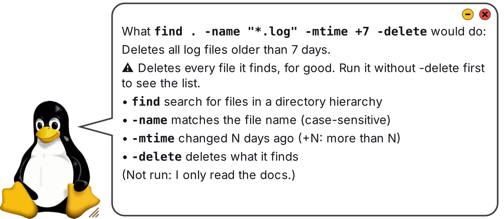

# Tux

A tiny, fully local Linux helper. Tux is a penguin-shaped desktop window with a
speech bubble. Ask him anything about Linux and he answers in a line or two with
the exact command, right on your machine. No cloud, no account.

His brain is a small AI model that runs on your own CPU: **Qwen2.5-Coder 1.5B**, run by
**llama.cpp**. 



## Install

```bash
git clone https://github.com/hartj77-blip/tux.git ~/tux
cd ~/tux && ./install.sh
```

That's it. Open **Tux** from your app grid, or press **Ctrl+Alt+Space** from anywhere (the
installer offers to set up that shortcut). The installer needs no sudo. It downloads llama.cpp
(~25 MB) and the Qwen2.5-Coder 1.5B model (~1 GB), then takes a few minutes.

**Needs:** x86_64 Linux, `curl`, and Python 3 with GTK4. Stock Ubuntu 22.04+ or Debian 12+ with GNOME
already has everything. Otherwise:

```bash
sudo apt install python3-gi gir1.2-gtk-4.0 python3-cairo python3-gi-cairo
sudo apt install python3-pil   # only if you want to use your own Tux picture
```

`install.sh` checks everything first and lists what's missing in one go, split into
**Required** and **Optional** (with what each adds), plus the install command for your
package manager (apt, dnf, pacman or zypper). It also test-runs llama.cpp before the big
model download, so an older system finds out right away instead of after "Done!".

## Uninstall

```bash
~/tux/uninstall.sh
```

It closes Tux and removes his app grid entry, his keyboard shortcut, his settings and his
`~/.bashrc` line (if you added it), then asks before deleting the `~/tux` folder with the model. No sudo needed. The
system packages from the install step stay, since other apps use them too.

## Using Tux

| Do this | What happens |
|---|---|
| Press **Ctrl+Alt+Space**, from any app | Tux pops up ready to type. Press it again to put him away, and you're back where you were |
| Click his belly or just start typing | Ask a question, press Enter |
| Click a command in the bubble | Copied to your clipboard (Tux never runs anything) |
| `Ctrl+C` / right-click the bubble | Copy the first command / the whole answer |
| Copy an error, then click Tux (or press the shortcut) | He offers to explain it: just press Enter |
| Ask "why did that fail?" | He looks at your last few terminal commands |
| Ask "install obs studio", "remove htop", "do I have git?" | Checked against your real apt/snap packages: the exact command that works on your machine, "already installed", or the closest matches |
| Type or paste a command, e.g. `tar -xzf a.tgz -C /tmp` or "what does `rm -rf ~/x` do?" | He says what it would do, part by part, and warns about anything risky. He never runs it ([more](#what-would-this-command-do)) |
| Copy a command, then click Tux and press Enter | The same breakdown for the copied command |
| Ask for "tips" or "tricks" | Instant power-user moves |
| Press **↑** / **↓** in the text box | Step back through your recent questions: each shows the answer he gave then, and Enter asks it again ([more](#recent-questions)) |
| `Ctrl+H` | Your recent questions, newest first. Click one to see its answer |
| Scroll the wheel over him, or `Page Up` / `Page Down` | Scrolls a long answer (a **more ↓** tag shows there's more; click it to jump down) |
| Click the 📖 link | Opens the matching GNOME Help page (no Help app installed? He shows the gist in the bubble and the command to install it) |
| Drag him | Move |
| Drag the lines on his right foot / `Ctrl+scroll` | Resize (Free Tux) |
| Click his icon in the top bar | Call him up / put him away. Right-click it for Settings or Quit ([more](#his-icon-in-the-top-bar)) |
| Yellow / red button on his head | Put away (into his top-bar icon, or minimized) / close |
| Hover over him | Brings his speech bubble back (it tucks away when idle) |
| Right-click him | **Settings** (see below) |

### Three ways to have him around

| | **Free Tux** (default) | **Mini Tux** (lowest profile) | **Mini Tux in the top bar** (out of sight) |
|---|---|---|---|
| Size | Resizable | Tiny penguin (44 px) and a compact text box | Same as Mini Tux, when he's down |
| His box | Grows to fit the answer, then shrinks back | Grows to fit the answer, then shrinks back | Grows to fit the answer, then shrinks back |
| Moving | Drag anywhere | Drag him and he slides along the screen edges | Drops down just under his top-bar icon. Drag him off the top to make him plain Mini Tux |
| Asking | Click his belly or just type | Click him or just type | Click his icon or press the shortcut, then type |
| When you're done | Stays put | Stays put | Pops back up into the top bar when his bubble would tuck away |
| On top of other windows | Optional (Settings → *Keep on top*) | Always, on every workspace | Always, on every workspace |

The top-bar mode needs a top bar that shows tray icons (see [below](#his-icon-in-the-top-bar)).

### Settings (right-click Tux)

Four short pages. Click a line to change it; it applies right away and is remembered
(`~/.config/tux/settings.json`).

| Page | Setting | Choices |
|---|---|---|
| **Where he lives** | Mode | Free Tux / Mini Tux on the screen edge / Mini Tux in the top bar |
| | Tux size | small / normal / large (Mini Tux; Free Tux resizes by dragging his foot) |
| | Bubble | right / left / above / below Tux (flipped if it would point or run off-screen) |
| | Keep on top | on / off (Mini Tux is always on top) |
| **Look** | Box width | narrow / normal / wide: how wide his box is when idle, and how long a command fits on one line (34 / 44 / 60 characters) |
| | Text size | small / normal / large |
| | See-through | solid / a little / half / glass (text stays solid) |
| | Theme | light / dark |
| **Behaviour** | Hide bubble after | 10 s / 20 s / 1 min / never |
| | Back to the top bar | when his bubble hides / only when I click (top-bar mode) |
| | When Tux starts | show him / stay in the top-bar icon |
| | Greeting tip | on / off: a power-user tip when he says hello |
| | Taskbar icon | on (default) / off: his icon in the top bar, and putting him away hides him there |
| **Extras** | Keyboard shortcut | Ctrl+Alt+Space / off. Change the keys in GNOME Settings → Keyboard → View and Customize Shortcuts → Custom Shortcuts → *Tux* |
| | Arch Wiki | off (default) / on: optional offline add-on, downloaded on request; can be deleted again |
| | Recent questions… | The same list as `Ctrl+H` |
| | Remember recent questions | on (default) / off: off also forgets what's saved |
| | Copy my settings | Copies every setting in plain words, to paste into a message |
| | Reset everything to defaults | Asks first; your notes stay |

Asking him to "stay on top" also offers the visible options. He remembers where you left him.

**His box fits the answer.** It stays small while he's idle or you're typing. For an answer it
gets wider until a command of up to 44 characters fits on one line (most of his commands are
shorter), and taller when there's more text, up to about 70% of your screen. The text always
stays at the size you picked: an answer longer than that scrolls instead (wheel, Page Up /
Page Down, or click **more ↓**). Tux himself stays put: the box grows beside him, picks his other
side if there's no room, and shrinks back when he goes idle.

**Long answers are laid out to scan.** ⚠ warnings sit in a tinted box in bold red, a command
breakdown lines up in two columns (the part, then what it does), and side notes such as
"(Not run: …)" are small and grey.

### Recent questions

Tux keeps your last 50 questions together with the answer he gave, so you can look back without
asking again:

- **↑ / ↓ in the text box** steps through them, like a terminal's history. The question goes in
  the box and the old answer shows right away. Enter asks it again, Esc goes back.
- **`Ctrl+H`** (or the top-bar icon menu, or Settings → Extras → *Recent questions…*) lists them
  newest first. Click one to see its answer, then *Ask it again* or go back to the list.
- They're saved on your machine only, in `~/.config/tux/recent.json` (readable only by you).
  Settings → Extras → *Remember recent questions: off* stops saving and deletes the file's
  contents; *Clear the list* in the list empties it.

### His icon in the top bar

While Tux is open, a small penguin sits in the top bar, next to the clock and battery icons. Click it to
call him up, click again to put him away; right-click it for **Show / hide Tux**, **Settings…**
and **Quit Tux**. Putting him away (the yellow button, the icon or the keyboard shortcut) then
hides him completely: no window and no dock entry, just the icon. He comes back in the same spot.

For the lowest profile, pick Settings → Mode → **Mini Tux in the top bar**. He then lives in
the icon: click it (or press the shortcut) and Mini Tux drops down just under the bar, right
below the icon; when you're done and his bubble would tuck away, he pops back up. (GNOME's
top bar itself only holds icons and extensions, so the icon is his home up there.)

Ubuntu shows these icons out of the box (its *Ubuntu AppIndicators* extension). KDE, XFCE,
Cinnamon, MATE and Budgie do too. Plain GNOME (Fedora, Debian) needs the
[AppIndicator and KStatusNotifierItem Support](https://extensions.gnome.org/extension/615/appindicator-support/)
extension; without it Tux just minimizes as before. Turn the icon off in
Settings → More settings → *Taskbar icon*.

### Trying out layouts (for testers)

Everyone likes Tux living somewhere different, so try a few:

1. Right-click Tux → **Mode**: try all three for a while (Free Tux, Mini Tux on an edge, Mini
   Tux in the top bar). Drag Mini Tux to the edge you like.
2. Try **Tux size** (first page) and **Box width** (Look page) until answers are easy to read.
3. On the **Behaviour** page, pick how long he stays out and whether he starts hidden.
4. When you've settled, **Extras → Copy my settings** and paste it into a message to whoever
   asked you to test. It lists every setting, with a `*` on the ones you changed.

From a terminal, the same list: `python3 ~/tux/tux.py --settings`. To start over:
`python3 ~/tux/tux.py --reset-settings` (with Tux closed), or **Extras → Reset everything to defaults**.

**The keyboard shortcut** is a GNOME custom shortcut that runs `tux.py --toggle`. Tux never
takes keys that something else already uses: if Ctrl+Alt+Space is taken, he says by what and
how to pick your own. On other desktops, add a shortcut in your keyboard settings that runs
`python3 ~/tux/tux.py --toggle`. From a terminal: `python3 ~/tux/tux.py --shortcut on|off|status`.

Nothing extra to install: GNOME on Wayland doesn't let apps keep themselves on top, so Tux runs
through XWayland (Ubuntu's built-in support for X11 apps), where that's allowed. To run him as a
plain Wayland app instead, set `TUX_WAYLAND=1`; he then can't stay on top or ride the edges.

### What would this command do?

Give Tux a command you found online, or one you're unsure about, and he explains it
**without running it**:

```
What `find . -name "*.log" -mtime +7 -delete` would do:
Deletes .log files here that are more than a week old.
⚠ Deletes every file it finds, for good. Run it without -delete first to see the list.
• `find` search for files in a directory hierarchy
• `-name` matches the file name (case-sensitive)
• `-mtime` changed N days ago (+N: more than N)
• `-delete` deletes what it finds
(Not run: I only read the docs.)
```

- **Each part comes from your own machine's docs**: the man page summary for each command,
  and the matching option lines from `--help` or the man page for each flag. Pipes, `&&`,
  `>`, `2>/dev/null`, `$(…)`, `sudo` and `tar xzf`-style flags are spelled out too.
- **⚠ warnings come from fixed rules, not the AI**: deleting (`rm -rf`, `find -delete`),
  wiping drives (`dd of=/dev/…`, `mkfs`, `> /dev/sda`), `chmod -R 777 /`, piping a download
  into `bash`, `git reset --hard`, `git push --force`, fork bombs, removing packages, running
  as root and more.
- **The one-line summary on top** is from the local model. Without the model, you still get
  the breakdown.
- Tux runs `--help` only for programs installed in the system folders, and never for risky
  ones (`rm`, `dd`, `kill`, `shutdown`…) or your own scripts. For those he reads the man page.

From a terminal (quote the command so your shell doesn't run any part of it):

```bash
python3 ~/tux/tux.py --explain 'curl -fsSL https://example.com/install.sh | sudo bash'
```

## The brain: a local AI model

| | |
|---|---|
| Model | [Qwen2.5-Coder-1.5B-Instruct](https://huggingface.co/Qwen/Qwen2.5-Coder-1.5B-Instruct-GGUF) by the Qwen team, Apache-2.0 |
| File | `models/qwen2.5-coder-1.5b-instruct-q4_k_m.gguf` (4-bit Q4_K_M, ~1 GB) |
| Runs on | [llama.cpp](https://github.com/ggml-org/llama.cpp) CPU build (`llama-server`), listening on `127.0.0.1` only; no GPU needed |
| Speed* | ~24 tokens/s (~18 words/s) on 3 CPU threads; loads in ~1 s; most answers in 1–2 s |
| Memory* | ~1.2 GB while loaded; unloaded after 5 minutes idle (Tux itself ~70 MB) |
| Privacy | Everything runs on your machine; no account, no API key, nothing sent anywhere |

\* Measured on an 8th-gen Intel laptop CPU (8 threads, 30 GB RAM, no GPU used).

Not every answer uses the model. These skip it and answer instantly:
- hand-checked answers for common tasks;
- the install helper, which checks your real apt/snap packages;
- tldr examples that clearly match;
- your own notes.

**Swap the model:** point `MODEL` at the top of `tux.py` to any GGUF chat model in `models/`.
For example, Qwen2.5 0.5B uses less RAM but gives weaker answers; a 3B model gives better
answers but runs about half as fast and needs about 2 GB of RAM.

## How it stays fast and light

- **Instant answers:** about 25 common tasks (ports, disk space, wifi, updates…) have
  hand-checked answers that skip the model entirely.
- **Grounded answers:** everything else goes to a local Qwen2.5-Coder 1.5B model via
  llama.cpp, fed the best matches from GNOME Help and man pages. Answers usually take 1–2 s.
- **Light on resources:** the model loads only when you start typing, runs on 3 CPU
  threads at low priority, and unloads after 5 minutes idle. With the model unloaded,
  Tux uses about 70 MB of RAM. Settings are at the top of `tux.py`.
- **Private:** recent commands are only read when your question points at them
  ("that", "it", "why…"). Lines that look like passwords or tokens are skipped.
  Nothing leaves your machine.

## Offline Linux library

`install.sh` builds a local, searchable library in `knowledge/` (SQLite full-text search, no
network needed after setup):

- **Full man pages** for every installed command, admin tool and config file (sections 1, 5, 8)
- **tldr pages**: short real-world examples for ~5,000 commands (3 MB download)
- **Live `--help`** from the commands you actually have installed (destructive tools are never run)
- **The Arch Wiki** (optional add-on, off by default): deep guides on boot, audio, networking,
  systemd and more. Turn it on in Settings → More settings → *Arch Wiki*; Tux downloads it in the
  background (19 MB, ~130 MB on disk). The same setting switches it off or deletes it.

What Tux does with it:

- **Instant tldr answers:** "curl download a file", "chown a folder recursively", "scp copy a
  file to another computer"… When an example clearly matches your question, you get it
  straight away, with no model involved.
- **A source link** under answers when there's a good one: the matching GNOME Help page, or the
  Arch Wiki page if you've turned it on.

Rebuild any time with `python3 knowledge.py build`. Search it yourself with
`python3 knowledge.py search "rsync exclude"`.

## Extras

- **Your own notes:** put `command : description` lines in `~/Helpful Linux Commands.txt`
  and Tux will use them.
- **Your own Tux art:** `python3 setup_tux.py path/to/picture.jpg` cuts out the white
  background and reshapes the window to fit.
- **Recent commands:** bash normally saves history only when a terminal closes. To let
  Tux see what you just ran, add this line to `~/.bashrc`. The installer offers to do it
  for you; it takes effect in new terminals.

  ```bash
  PROMPT_COMMAND="history -a${PROMPT_COMMAND:+; $PROMPT_COMMAND}"
  ```

## Credits & license

Tux the penguin artwork was created by Larry Ewing (lewing@isc.tamu.edu) using The GIMP.

Code is MIT licensed (see `LICENSE`). The model (Qwen2.5-Coder, Apache-2.0) and
llama.cpp (MIT) are downloaded from their own projects by `install.sh`, as are the
[tldr pages](https://github.com/tldr-pages/tldr) (CC BY 4.0, © the tldr-pages authors) and the
[ArchWiki](https://wiki.archlinux.org) (GNU FDL 1.3, © ArchWiki contributors). None of them
are included in this repository.
